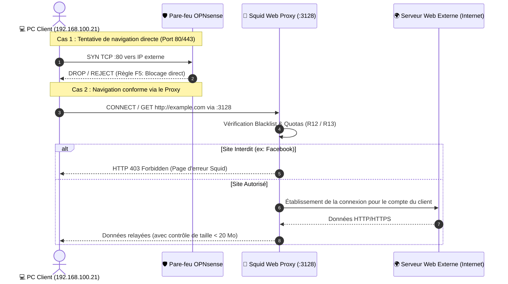
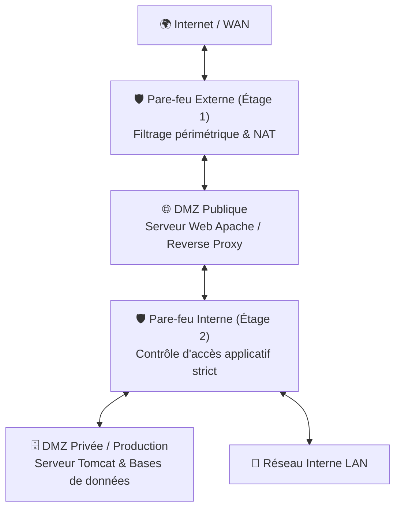
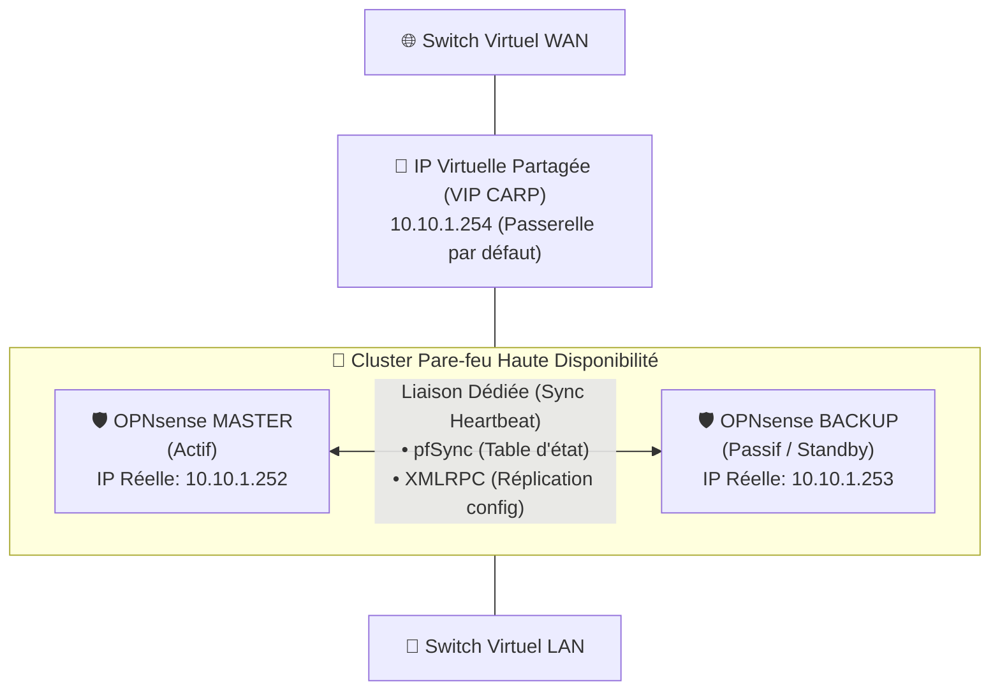

# 🏛️ Étude Avancée : Architecture en 2 Étages, Forçage Proxy & Haute Disponibilité (HA)

Ce document présente l'analyse d'ingénierie réseau et les concepts d'architecture avancés étudiés dans le cadre de ce projet de sécurisation.

**Auteur :** [Soufiane MAJD](https://github.com/SoufianeMajd) — *Élève-Ingénieur en Génie Informatique*

---

## 1. Mécanisme de Forçage du Proxy Web (Squid)

Dans une architecture d'entreprise, les utilisateurs internes ne doivent pas pouvoir naviguer librement sans contrôle applicatif (filtrage d'URL, analyse antivirus de flux, quotas de bande passante).

---

## 2. Architecture Pare-Feu en Deux Étages (Two-Tier Firewalls)

Pour les infrastructures critiques, une architecture à double étage de pare-feu permet de cloisonner le risque en évitant le point unique de compromission (*Single Point of Failure* sécuritaire) :

### Avantages Majeurs :
* **Hétérogénéité des technologies** : Il est possible d'utiliser deux systèmes pare-feu différents (ex: OPNsense en frontal, pfSense ou iptables/nftables en interne) pour qu'une vulnérabilité zero-day sur un système ne donne pas accès à l'ensemble du réseau.
* **Séparation des responsabilités** : Le pare-feu externe gère l'exposition publique et les flux massifs d'Internet, tandis que le pare-feu interne protège les actifs vitaux (ERP, RH, bases de données relationnelles).

---

## 3. Schéma de Haute Disponibilité Actif-Passif (Cluster OPNsense CARP)

Afin de prévenir toute interruption de service en production, l'architecture a été conçue pour supporter un basculement automatique (*Failover*) transparent :

### Protocoles et Synchronisation :
1. **CARP (Common Address Redundancy Protocol)** : Partage d'une adresse IP Virtuelle (VIP) entre les deux nœuds. En fonctionnement normal, seul le nœud Maître répond aux requêtes ARP.
2. **pfSync** : Synchronise en temps réel la table des états de connexion (*State Table*) à travers un lien réseau dédié. En cas de panne matérielle du Maître, les sessions TCP actives des utilisateurs (téléchargements, appels Web) ne sont pas interrompues.
3. **XMLRPC Sync** : Toute modification apportée aux règles de pare-feu, aux alias ou aux paramètres Squid sur le Maître est automatiquement répliquée sur le Backup.

